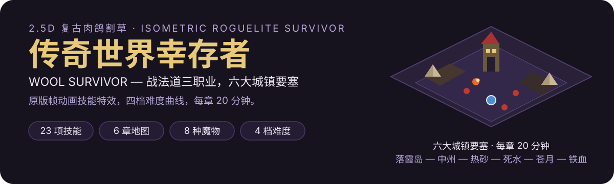
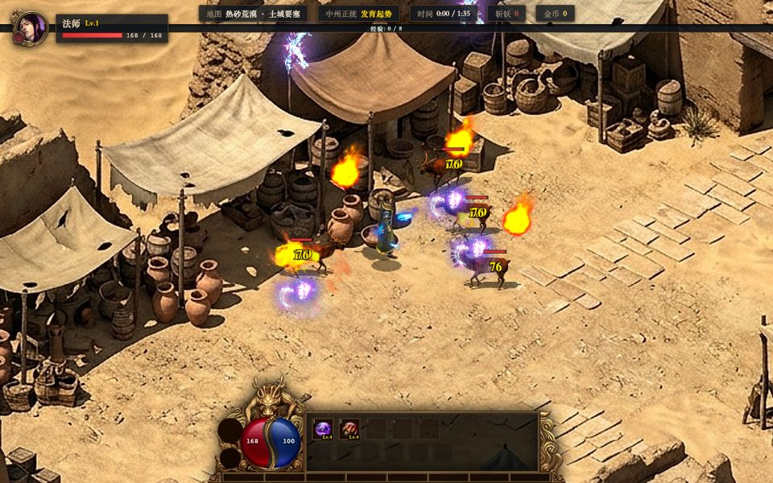
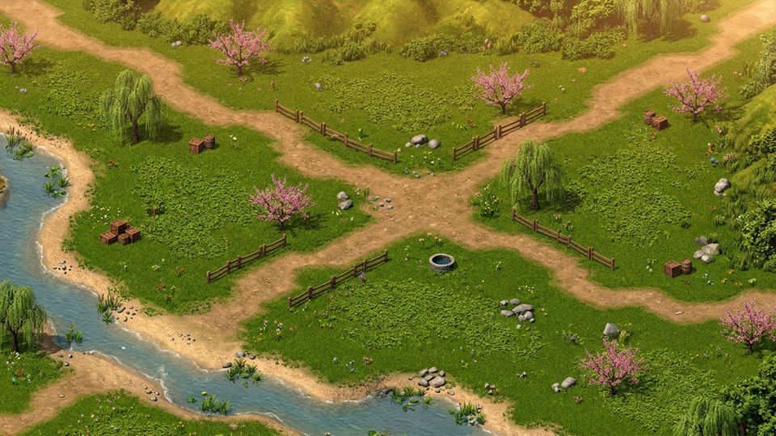

<p align="right"><a href="README.md">中文</a></p>

<p align="center">
  
</p>

<p align="center">
  <a href="https://xiaosang.cc/woool-survivor-game/">▶ Play Online</a>
  ·
  <a href="https://github.com/holynova/woool-survivor-game">GitHub Repository</a>
</p>

Woool Survivor is a retro 2.5D isometric roguelite survivor built with authentic The World of Legend (Woool) visual assets: Warrior, Wizard and Taoist, 23 skills with original sprite animations, six illustrated citadel and town maps, and four difficulty curves from casual swarm-clearing to hardcore boss endurance. Built with React + Phaser 3. Best played on desktop.

## Screenshots

<p align="center">
  
  
</p>

## How to Play

- **Three classes**: 战士 Warrior — melee swordplay (7 skills), 法师 Wizard — elemental magic (8 skills), 道士 Taoist — talismans and summons (8 skills), each with its own skill pool.
- **Six chapters**: 落霞岛桃林原野 (Sunset Isle), 中州王城近郊 (Central State), 热砂荒漠戈壁 (Hot Desert), 死水沼泽禁地 (Deadwater Marsh), 玄冰雪原极地 (Frozen Citadel), 铁血魔渊熔岩 (Iron Citadel) — 20 minutes each, kill targets rising from 600 to 1,600, chapter bosses from 12,000 to 52,000 HP.
- **Four difficulties**: 逍遥割草 (Casual), 中州正统 (Standard), 狂潮骤变 (Surge), 铁血炼狱 (Hell), each with its own spawn density and intensity curve.
- **Builds**: 23 skills plus 6 passive relics （传世神兵玄晶 Divine Weapon Crystal, 风雷神行步 Wind-Thunder Stride, 天山雪莲玉髓 Tianshan Snow Lotus Jade, 深渊魔晶珠 Abyssal Demon Crystal, 太极洗髓金丹 Taiji Marrow-Cleansing Elixir, 玛法乾坤引力石 Mir Gravity Stone).
- **8 monsters**: 稻草人 (Scarecrow), 狂暴角鹿 (Frenzied Antlered Deer), 剧毒蟒蛇 (Venomous Python), 红野猪 (Red Boar), 妖化刀犬 (Demon Blade Hound), 白骨骷髅 (Skeleton), 双斧骷髅将 (Twin-Axe Skeleton General), 赤炎兽傀儡 (Crimson Flame Beast Puppet).

## Run Locally

```bash
npm install
npm run dev
```

Difficulty-curve simulation:

```bash
npm test
```

## Tech

- React 19 (UI) + Phaser 3.90 (2.5D isometric combat rendering) + TypeScript + Vite.
- Data-driven: chapters, skills, and difficulty curves are defined in `src/config/` (`chapters.ts` / `skills.ts` / `curves.ts`); original sprite atlases (plist + PNG) and skill-effect frame animations live in `public/assets/woool/`.
- Difficulty curves are validated offline with `tests/simulate_curves.mjs`; `scripts/verify_pacing_and_cd.mjs` and `verify_skills_evolution.mjs` check pacing and skill progression.

```
src/App.tsx             UI: lobby / character select / chapters / results
src/game.ts             Combat loop: spawning, skills, bosses, kill targets
src/renderer.ts         Phaser rendering: isometric maps, sprite animations, skill effects
src/config/chapters.ts  6 chapter definitions: map / boss / kill target / duration
src/config/skills.ts    23 skills + 6 passive relics
src/config/curves.ts    8 monsters + 4 difficulty curves
src/audio.ts            Sound effects and background music
public/assets/woool/    Original Woool art assets (sprites / maps / effects / audio)
tests/simulate_curves.mjs  Offline difficulty-curve simulation
```

## Disclaimer

Unofficial fan work using Woool-style art assets, not affiliated with Shanda Games. This repository does not declare an overall open-source license.
