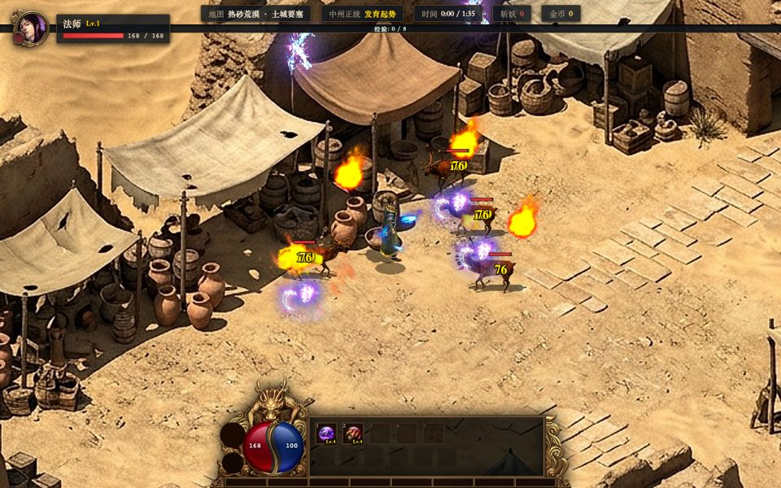

<p align="right"><a href="README.en.md">English</a></p>

<p align="center">
  
</p>

<p align="center">
  <a href="https://xiaosang.cc/woool-survivor-game/">▶ 在线玩</a>
  ·
  <a href="https://github.com/holynova/woool-survivor-game">GitHub 仓库</a>
</p>

传奇世界幸存者是一款基于经典端游《传奇世界》美术资产的 2.5D 复古肉鸽割草游戏：战士、法师、道士三职业，23 项技能配原版帧动画特效，在六大写实城镇要塞里迎战怪潮，四档难度从逍遥割草到铁血炼狱。React + Phaser 3 驱动，桌面端游玩。

## 截图

<p align="center">
  
  
</p>

## 玩法

- **三职业**：战士近战剑术（7 项技能）、法师元素魔法（8 项）、道士符箓召唤（8 项），各有专属技能池。
- **六大章节**：落霞岛桃林原野、中州王城近郊、热砂荒漠戈壁、死水沼泽禁地、玄冰雪原极地、铁血魔渊熔岩；每章 20 分钟，击杀目标 600–1600 递增，章末 Boss 血量 12,000–52,000。
- **四档难度**：逍遥割草、中州正统、狂潮骤变、铁血炼狱，刷怪密度与强度曲线各不相同。
- **构筑**：23 项技能 + 6 件被动宝物（传世神兵玄晶、风雷神行步、天山雪莲玉髓、深渊魔晶珠、太极洗髓金丹、玛法乾坤引力石）。
- **8 种魔物**：稻草人、狂暴角鹿、剧毒蟒蛇、红野猪、妖化刀犬、白骨骷髅、双斧骷髅将、赤炎兽傀儡。

## 本地运行

```bash
npm install
npm run dev
```

难度曲线模拟验证：

```bash
npm test
```

## 技术

- React 19（界面）+ Phaser 3.90（2.5D 等距战斗渲染）+ TypeScript + Vite。
- 数据驱动：章节、技能、难度曲线分别定义在 `src/config/`（`chapters.ts` / `skills.ts` / `curves.ts`）；原版精灵图集（plist + PNG）与技能特效帧动画在 `public/assets/woool/`。
- 难度曲线用 `tests/simulate_curves.mjs` 做离线模拟验证；另有 `scripts/verify_pacing_and_cd.mjs` 与 `verify_skills_evolution.mjs` 校验节奏与技能成长。

```
src/App.tsx             界面：大厅 / 选角 / 章节 / 结算
src/game.ts             战斗主循环：刷怪、技能、Boss、击杀目标
src/renderer.ts         Phaser 渲染：等距地图、精灵帧动画、技能特效
src/config/chapters.ts  6 章定义：地图 / Boss / 击杀目标 / 时长
src/config/skills.ts    23 技能 + 6 被动宝物
src/config/curves.ts    8 种魔物 + 4 档难度曲线
src/audio.ts            音效与背景音乐
public/assets/woool/    传奇世界原版美术资产（精灵 / 地图 / 特效 / 音效）
tests/simulate_curves.mjs  难度曲线离线模拟
```

## 声明

本仓库使用《传奇世界》风格美术资产做非官方二次创作，与盛趣游戏无关；本仓库未声明整体开源协议。
