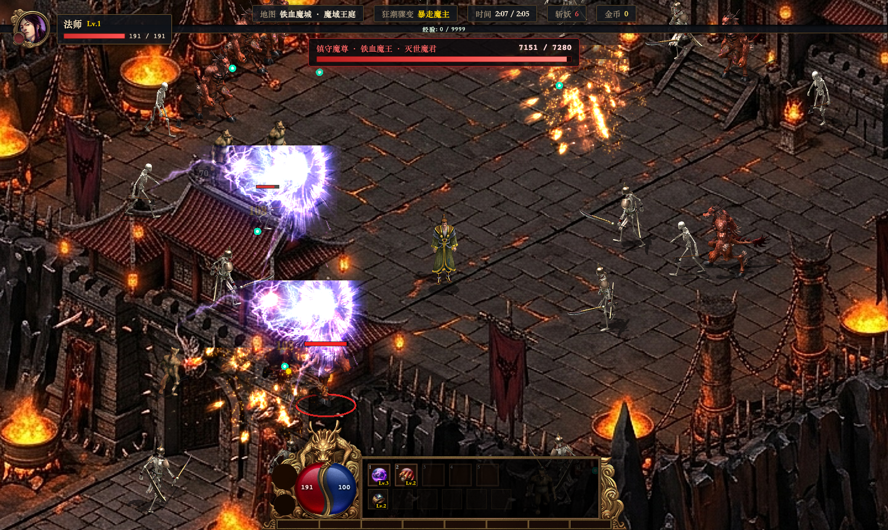

# 传奇世界幸存者 / Woool Survivor

中文：基于经典端游《传奇世界》美术资产打造的 2.5D 复古肉鸽生存割草网页游戏。包含战法道三职业、原版帧动画技能特效与道具系统、六大高清写实城镇要塞地图（落霞岛桃林港镇、中州王城要塞、热砂荒漠土城、死水沼泽禁地、苍月雪城古刹、铁血魔城王庭）以及四种差异化难度曲线（逍遥割草、中州正统、狂潮骤变、铁血炼狱）。

English: A retro 2.5D isometric roguelite survivor RPG built with authentic The World of Legend (Woool) visual assets. Play as Warrior, Wizard, or Taoist across six illustrated citadel and town maps using original sprite skill animations, equipment relics, and four tuned difficulty curves ranging from casual swarm clearing to hardcore boss endurance runs.



## 在线体验 / Live Demo

- [Cloudflare Demo](https://xiaosang.cc/woool-survivor-game/)
- [GitHub Repo](https://github.com/holynova/woool-survivor-game)


## 本地运行 / Run locally

```bash
npm install
npm test
npm run dev
```

## 发布 / Deploy

```bash
npm run build
npm run deploy:check
npm run deploy
```

Cloudflare Workers · Subpath Route: `https://xiaosang.cc/woool-survivor-game/`

源码与部署配置统一维护在 `main` 主分支，在本地构建并手动通过 Wrangler 发布。
